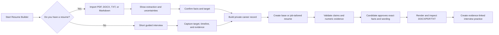
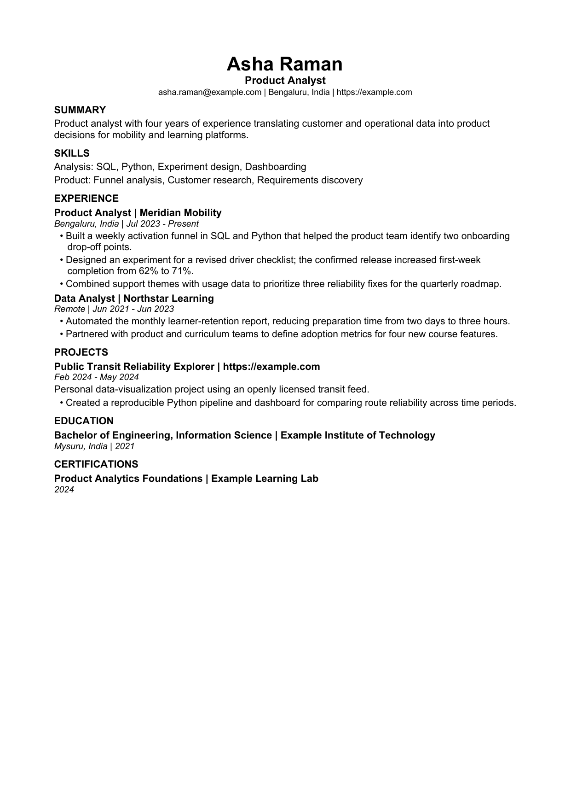

# No. 1 Resume Builder Skill

> A free, open-source Codex skill for building truthful, job-targeted resumes and interview practice—from an existing resume or from scratch.


**Repository name:** `no1-resume-builder-skill`  
**Installable skill ID:** `resume-builder`

“No. 1” is the project name and mission, not a claim of an independently verified market ranking. No resume can guarantee an interview or job.

## Why this project exists

Most resume tools begin with a template. This project begins with evidence.

It helps a person recover the facts of their career, understand what a target job requires, select the most relevant evidence, write clearly without fabrication, produce usable files, inspect what those files actually contain, and practice interviews from the same approved material.

Privacy note: the bundled Python helper makes no network calls and omits full extracted resume text from session files by default. Codex or another AI host may still process attachments according to that platform's data controls. Do not upload unnecessary sensitive data, and review your account/workspace settings.

It is intended for students, first-job applicants, experienced professionals, career changers, returners, freelancers, skilled tradespeople, healthcare workers, researchers, public servants, executives, and people in uncommon occupations.

## Start in under two minutes

After downloading or cloning the repository, copy `skills/resume-builder` into a Codex skills directory.

### macOS or Linux

```bash
mkdir -p ~/.agents/skills
cp -R skills/resume-builder ~/.agents/skills/resume-builder
```

### Windows PowerShell

```powershell
New-Item -ItemType Directory -Force "$env:USERPROFILE\.agents\skills" | Out-Null
Copy-Item -Recurse skills\resume-builder "$env:USERPROFILE\.agents\skills\resume-builder"
```

Then ask Codex:

```text
Use $resume-builder. I have an old resume and want to target product manager jobs in India.
```

or:

```text
Use $resume-builder. I do not have a resume. Help me build one from scratch for registered nurse roles in the UAE.
```

Codex normally detects new skills automatically. Restart it if the skill does not appear.

## Two ways to begin



### Path A: Use an old or current resume

The skill:

1. preserves the original file;
2. extracts its text locally;
3. reports what it found before rewriting;
4. flags ambiguous dates, metrics, outdated details and parsing problems;
5. asks the candidate to confirm material facts;
6. creates a reusable master career record;
7. produces a base resume or job-specific variant;
8. renders and verifies the requested formats.

### Path B: Start from scratch

The skill asks no more than three questions per round. A person can answer in rough notes, say “skip,” say “not sure,” or return later. It drafts as soon as enough real evidence exists instead of forcing the person through a long form.

Typical progress:

```text
Target ✓ · Contact ✓ · Experience 2/3 · Evidence 1/2 · Fact-check pending
```

## What it produces

- A private master career record with evidence provenance.
- A reusable base resume.
- Job-specific tailored variants.
- A requirement-to-evidence matrix.
- Editable DOCX.
- Text-selectable PDF.
- TXT and Markdown inspection copies.
- Extraction compatibility report.
- Fact-check and assumptions list.
- Resume-grounded interview questions and answer outlines.

The employer's application instructions control the submitted format.

## Example output

The example below is entirely synthetic. It is included to demonstrate layout and verification, not to imply a real candidate outcome.



Download the [sample DOCX](examples/product-analyst/Asha_Raman_Product_Analyst_Resume.docx), [sample PDF](examples/product-analyst/Asha_Raman_Product_Analyst_Resume.pdf), [plain-text extraction](examples/product-analyst/Asha_Raman_Product_Analyst_Resume.txt), or [interview kit](examples/product-analyst/interview-practice.md).

## Evidence behind the design

This repository does not rely on generic “ATS secrets.” It compares official employer-system documentation, government requirements, university career guidance, occupational taxonomies, research studies, and established open-source builders.

| Source | Short source language | What it changed in the skill |
|---|---|---|
| [Greenhouse parsing failures](https://support.greenhouse.io/hc/en-us/articles/200989175-Unsuccessful-resume-parse) | “Complex resumes with tables, headers, and footers” | One-column, table-free default; body-level contact information; real extraction testing |
| [Greenhouse supported formats](https://support.greenhouse.io/hc/en-us/articles/360052218132-Supported-formats-for-resumes-cover-letters-and-other-candidate-uploads) | DOC, DOCX, PDF, RTF and TXT are supported | Generate DOCX and text-selectable PDF; follow the application instructions |
| [Harvard career services](https://careerservices.fas.harvard.edu/resources/create-a-strong-resume/) | “Specific rather than general” and “Fact-based” | Specific, active, evidence-grounded writing and job tailoring |
| [Yale career strategy](https://ocs.yale.edu/resources/writing-impactful-resume-bullets/) | “Action + Project + Result” | Flexible accomplishment prompts that distinguish personal contribution |
| [USAJOBS](https://help.usajobs.gov/faq/application/documents/resume/what-to-include) | The announcement controls required qualifications and details | A separate US-federal workflow instead of forcing private-sector conventions |
| [Europass](https://europass.europa.eu/en/create-europass-cv) | “Focus on facts and main points” | Regional adaptation and reusable career information for multiple CVs |
| [O*NET](https://www.onetcenter.org/database.html) and [ESCO](https://esco.ec.europa.eu/en/use-esco/use-esco-services-api/esco-web-service-api) | Structured occupation and skill terminology | Domain-aware questions without assigning unverified skills to a candidate |
| [MIT Sloan field experiment](https://mitsloan.mit.edu/ideas-made-to-matter/job-seekers-ai-boosted-resumes-more-likely-to-be-hired) | Writing assistance improved outcomes in a large experiment | Improve clarity, spelling and grammar without inventing qualifications |
| [JSON Resume](https://github.com/jsonresume/resume-schema) | Open structured resume schema | A canonical JSON career record with validation |
| [Reactive Resume](https://github.com/AmruthPillai/Reactive-Resume) | Privacy, ownership and portable exports | Network-free helper, minimal saved intake data, AI-host disclosure, and reusable structured data |
| [OpenResume](https://github.com/xitanggg/open-resume) | Builder plus parser | Import an existing resume and show what extracted |
| [RenderCV](https://github.com/rendercv/rendercv) | Content-as-data and reproducible rendering | Deterministic output and source-controlled career records |

Read [Sources and design decisions](docs/sources-and-design-decisions.md) for the full mapping, caveats and links. The runtime [source register](skills/resume-builder/references/sources.md) records the primary references available to the skill.

## What “world-class” means here

It does **not** mean a magical template or guaranteed ATS ranking. It means the workflow aims to be:

- truthful: material claims are evidence-backed or candidate-confirmed;
- targeted: the job's requirements are mapped to relevant evidence;
- readable: clear hierarchy, restrained typography and natural language;
- extractable: actual document text is inspected after rendering;
- adaptable: domain, career stage, country and document type can change;
- private by design: the helper makes no uploads/network calls, saves minimal intake data by default, and discloses AI-host processing;
- auditable: sources, gaps, assumptions and unsupported requirements remain visible;
- useful after the resume: interview practice reuses the approved evidence.

## Industry and career-stage coverage

The deterministic router contains 26 transparent domain entries covering:

- software, cloud, data, AI, cybersecurity and IT;
- product, project, program, UX and creative design;
- marketing, communications, sales, customer success and support;
- finance, accounting, banking, investment, consulting, legal and compliance;
- operations, supply chain, logistics, manufacturing, quality, construction and trades;
- clinical healthcare, public health, social care, pharma, biotech and life sciences;
- education, training, academia and research;
- government, nonprofit and social impact;
- retail, hospitality, food service, customer service and administration;
- executive, founder and enterprise leadership.

Career-stage overlays cover students, first-job candidates, career changers, returners, freelancers, contractors, executives, and people with limited formal education. An evidence-first general profile handles unmatched or emerging work.

Domain routing chooses better questions. It never proves that the candidate possesses a typical skill, credential, license or legal authorization.

## Tested examples

The repository includes behavioral evaluations for:

- a registered nurse starting from scratch;
- an electrician importing an old PDF;
- a hospitality supervisor without reliable percentage metrics;
- software, teaching and financial-analysis occupations;
- an unknown occupation using the general fallback;
- an engineering student whose metrics must not be invented;
- an operations leader with a verified $4.2M scope when the job asks for $10M;
- a German academic CV that must not inherit a private-sector page limit;
- a two-column PDF audit that must report observable extraction rather than a fake ATS score.

See [Tested examples](docs/tested-examples.md) and [evaluation prompts](evals/evals.json).

## Validation performed

- 19 deterministic automated tests pass.
- Unsupported or unverified final claims are blocked.
- Numeric detail must appear in cited evidence.
- Old-resume import does not overwrite the source.
- Intake batches contain no more than three questions.
- DOCX and PDF are generated without layout tables.
- The synthetic DOCX and PDF passed visual inspection.
- Both demonstration files preserved all 200 expected material tokens during extraction.
- The source skill and unpacked `.skill` archive pass the official Codex skill validator.

This is an observable extraction check, not an ATS ranking or prediction of employer behavior.

## Local helper commands

Python 3.10 or newer is recommended.

```bash
python -m pip install -r requirements.txt
```

Start from scratch:

```bash
python skills/resume-builder/scripts/resume_tool.py start \
  --journey scratch \
  --role "Registered Nurse" \
  --region "UAE" \
  --out private/session.intake.json
```

Import an existing resume:

```bash
python skills/resume-builder/scripts/resume_tool.py start \
  --journey existing-resume \
  --source old-resume.pdf \
  --role "Product Manager" \
  --region "India" \
  --out private/session.intake.json
```

Inspect progress or route a domain:

```bash
python skills/resume-builder/scripts/resume_tool.py status private/session.intake.json
python skills/resume-builder/scripts/resume_tool.py domain "supply chain and procurement manager"
```

Validate, render and verify:

```bash
python skills/resume-builder/scripts/resume_tool.py validate \
  skills/resume-builder/examples/sample-career-record.json

# For a candidate's own draft, run this only after they confirm every material fact:
python skills/resume-builder/scripts/resume_tool.py approve \
  private/draft.career-record.json \
  --out private/approved.career-record.json

python skills/resume-builder/scripts/resume_tool.py render \
  skills/resume-builder/examples/sample-career-record.json \
  --outdir build/sample

python skills/resume-builder/scripts/resume_tool.py verify \
  skills/resume-builder/examples/sample-career-record.json \
  build/sample/Asha_Raman_Product_Analyst_Resume.pdf
```

Intake sessions contain personal career data. Full extracted text is omitted by default; do not commit sessions to a public repository.

## Repository structure

```text
.
├── skills/resume-builder/       Installable runtime skill
│   ├── SKILL.md                 Core agent workflow
│   ├── agents/openai.yaml       Skill-list metadata
│   ├── scripts/resume_tool.py   Intake, routing, validation and rendering
│   ├── schemas/                 Career-record and intake contracts
│   ├── references/              Domain, region, privacy and writing guidance
│   └── examples/                Canonical synthetic career record
├── examples/                    Public rendered example and interview kit
├── docs/                        Research, journeys, domains and maintenance
├── evals/                       Behavioral and trigger evaluations
├── tests/                       Deterministic test suite
└── .github/                     CI and contribution templates
```

Repository documentation stays outside the runtime skill so installed skills remain lean.

## What this project deliberately does not do

- It does not scrape or redistribute personal resumes.
- It does not use a celebrity's promotional resume as a universal base.
- It does not invent employers, dates, credentials, metrics or outcomes.
- It does not copy skills from a job description without evidence.
- It does not force every resume to one page.
- It does not claim PDF is always better than DOCX.
- It does not expose a predictive ATS score.
- It does not submit applications, send emails or contact employers.
- It does not promise an interview or job.

## Research and privacy position

Public availability does not remove privacy, consent, copyright, provenance or bias concerns from personal resumes. This project therefore uses authoritative guidance, aggregate research, licensed occupational vocabularies, consented or synthetic fixtures, and observable tests instead of packaging a scraped resume corpus.

Read the [research foundation](docs/research-foundation.md), [privacy guidance](skills/resume-builder/references/privacy-and-data.md), and [third-party notices](THIRD_PARTY_NOTICES.md).

## Contributing

Contributions are welcome, especially:

- country and language guidance;
- domain prompts reviewed by practitioners;
- accessibility improvements;
- synthetic or consented parser fixtures;
- factuality and extraction tests;
- improvements for people with nontraditional career histories.

Read [CONTRIBUTING.md](CONTRIBUTING.md), [SECURITY.md](SECURITY.md), and [CODE_OF_CONDUCT.md](CODE_OF_CONDUCT.md).

## GitHub publication settings

The recommended repository settings, description, topics and release assets are in [GitHub publishing](docs/github-publishing.md).

## License

[MIT](LICENSE). No third-party resume corpus or source code is bundled.
